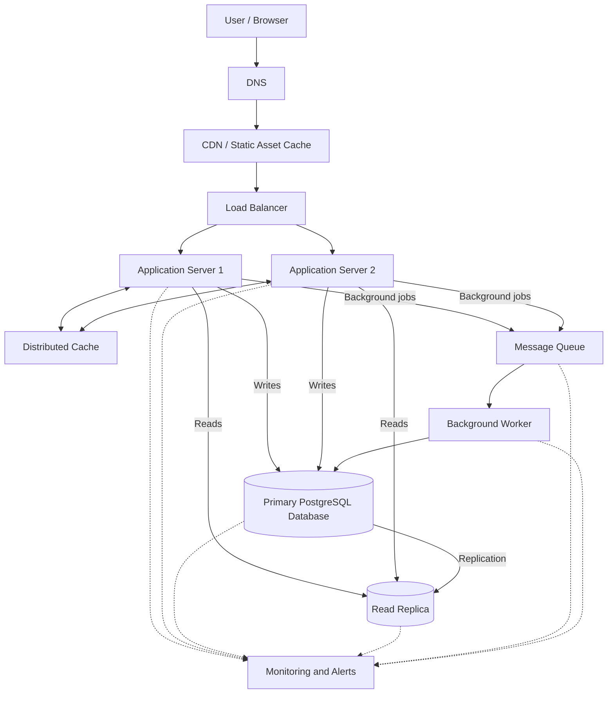

# QuickNotes System Architecture

## 1. Overview

QuickNotes is a note-taking service that allows users to create, read, update, delete, and organize notes with tags. The initial application uses JSONPlaceholder to demonstrate API requests, while the production system described here uses a real backend and database.

The architecture is designed to support one million registered users, handle increasing traffic, protect user data, and remain available when individual components fail.

## 2. Functional Requirements

1. Users can register, log in, and securely access their accounts.
2. Users can create notes with a required title and an optional body.
3. Users can view, search, update, and delete their notes.
4. Users can organize notes using tags.
5. Users can access their notes from different devices.
6. Users can paginate through large collections of notes.
7. The system validates input and prevents unauthorized access to notes.

## 3. Non-Functional Requirements

1. **Scalability:** The system should support one million registered users and allow additional servers to be added as traffic grows.
2. **Availability:** The target availability is 99.9%, supported by redundancy and health monitoring.
3. **Performance:** Aim for a p95 response time below 300 ms for ordinary note reads under the planned workload, excluding unusually slow client networks.
4. **Security:** Use HTTPS, secure password hashing, authentication, authorization, and parameterized database queries.
5. **Reliability:** Prevent individual server failures from causing a complete service outage.
6. **Data integrity:** Use database transactions, constraints, backups, and tested recovery procedures.
7. **Maintainability:** Separate the client, application logic, database, and background processing into manageable components.

These are design targets that must be verified through testing and monitoring.

## 4. Load Estimates for One Million Users

### Assumptions

- Total registered users: 1,000,000.
- Daily active users: 10% of registered users, or 100,000.
- Each daily active user performs 40 note-list or note-read requests per day.
- Each daily active user creates 2 notes per day.
- Average stored note content and metadata: 2 KB per note.
- Average workload is calculated over 86,400 seconds per day.
- Peak traffic is estimated at five times the average request rate.

### Reads per second

Daily reads:

100,000 active users × 40 reads = 4,000,000 reads/day.

Average reads per second:

4,000,000 ÷ 86,400 = approximately 46.3 reads/second.

Estimated peak reads:

46.3 × 5 = approximately 232 reads/second.

### Writes per second

Daily writes:

100,000 active users × 2 notes = 200,000 note creations/day.

Average writes per second:

200,000 ÷ 86,400 = approximately 2.3 writes/second.

Estimated peak writes:

2.3 × 5 = approximately 11.6 writes/second.

These estimates count note creations as writes; updates, deletions, tag operations, and other database writes would add to the actual workload.

### Storage per year

Daily storage growth:

200,000 notes × 2 KB = 400,000 KB/day, approximately 400 MB/day using decimal units.

Annual storage growth:

400 MB × 365 = approximately 146 GB/year.

This is an estimate of raw note content and metadata, excluding indexes, database overhead, replicas, logs, backups, and other application data.

### Summary

| Metric | Estimated value |
|---|---:|
| Registered users | 1,000,000 |
| Daily active users | 100,000 |
| Average reads/second | 46.3 |
| Estimated peak reads/second | 232 |
| Average note creations/second | 2.3 |
| Estimated peak note creations/second | 11.6 |
| Raw note storage growth/year | 146 GB |

The application is expected to be **read-heavy**, with about 20 reads for every note creation under these assumptions. Caching, indexed database queries, and read replicas can help manage the read workload.

These estimates are planning assumptions, not measured production traffic. They should be revised using real usage data and load tests.

## 5. Architecture Diagram

The diagram represents a logical architecture. Production deployment should use redundant instances and managed or clustered services where appropriate.

## 6. Architecture Components

### 6.1 Client / Browser

The browser provides the user interface and sends HTTPS requests to the backend API.

### 6.2 DNS

DNS translates the public service domain into the appropriate network destination so clients can locate QuickNotes.

### 6.3 CDN

The content delivery network caches and serves static assets such as CSS, JavaScript, and images from locations closer to users, reducing latency and origin-server traffic.

### 6.4 Load Balancer

The load balancer distributes incoming API requests across healthy application servers and removes unhealthy instances from rotation.

### 6.5 Application Servers

At least two application server instances process API requests, enforce authentication and authorization, validate input, and communicate with the database and other services.

### 6.6 Distributed Cache

A shared cache, such as Redis, stores frequently accessed data temporarily to reduce repeated database reads and improve response times.

Cache entries must be isolated by user where appropriate, and note updates or deletions must invalidate or refresh affected entries.

### 6.7 Primary Database

The primary PostgreSQL database handles durable writes and maintains the authoritative records for users, notes, tags, and note-tag relationships.

### 6.8 Read Replica

The read replica serves suitable read queries, reducing pressure on the primary database and allowing read capacity to scale independently.

Because replication can be delayed, some reads may return slightly stale data, and read-after-write requests may need to go to the primary.

### 6.9 Message Queue

The queue stores background jobs so non-essential tasks can be processed asynchronously instead of delaying the user's API response.

Examples include sending notifications, processing exports, and performing other deferred tasks.

### 6.10 Background Worker

The worker consumes queued jobs, performs the required background processing, retries transient failures, and records failures for investigation.

### 6.11 Monitoring and Alerts

Monitoring collects metrics, logs, health checks, and error information so the engineering team can detect incidents and respond before they become larger outages.

## 7. Request Flow: GET /notes

1. The user opens QuickNotes and requests their notes.
2. DNS resolves the service domain, and the request reaches the load balancer through the appropriate network path.
3. The load balancer forwards the request to a healthy application server.
4. The application server validates the access token and identifies the authenticated user.
5. The server validates pagination and other query parameters.
6. The server checks the cache for a matching user-specific result.
7. If a valid cache entry exists, the server returns the cached result; otherwise, it queries the read replica when replica consistency is acceptable.
8. The database returns notes filtered by the authenticated user's ID, with indexed ordering and pagination.
9. The application server formats the response as JSON and may cache the result for a short period.
10. The browser receives the response and renders the notes.

If a request requires the latest committed data, the application can read from the primary database instead of the replica.

## 8. Request Flow: POST /notes

1. The user submits a new note from the browser.
2. The request travels over HTTPS to the load balancer.
3. The load balancer forwards it to a healthy application server.
4. The application server authenticates the user and validates the note title and body.
5. The server derives the owner ID from the authenticated identity rather than trusting a client-supplied owner ID.
6. The application server inserts the note into the primary PostgreSQL database using a parameterized query or transaction.
7. The database enforces constraints and commits the new note.
8. The application invalidates or updates relevant cached note lists.
9. The application returns `201 Created`, the new note representation, and a `Location` header identifying the resource.
10. If necessary, the application publishes background jobs to the message queue for non-essential work; a worker processes those jobs independently.

The API should not acknowledge a note creation as successful until the database transaction has committed. Queue failures must be handled separately so they do not incorrectly reverse a successfully committed note creation.

For reliable delivery of critical background events, the backend can use a transactional outbox pattern, which records the event in the same database transaction as the note change.

## 9. Architecture Trade-Offs

### Trade-Off 1: Cache versus consistency

**Benefit:** Caching reduces database load and improves response times for frequently requested notes.

**Cost:** Cached data can become stale, and invalidation introduces additional complexity.

**Decision:** Use short cache lifetimes and invalidate affected entries after writes. Route read-after-write operations to the primary when immediate consistency is required.

### Trade-Off 2: Read replica versus consistency

**Benefit:** A read replica distributes read traffic and allows the primary database to focus on writes.

**Cost:** Asynchronous replication may cause recently updated notes to appear stale.

**Decision:** Use replicas for ordinary list and read requests where small delays are acceptable, and use the primary for operations that require the latest committed data.

### Trade-Off 3: Multiple application servers versus cost

**Benefit:** Multiple application servers increase capacity and allow traffic to continue when one instance fails.

**Cost:** Additional instances increase infrastructure cost and require shared session or cache management.

**Decision:** Keep at least two healthy application instances in service and scale the number of instances according to measured traffic and resource utilization.

### Trade-Off 4: Asynchronous jobs versus operational complexity

**Benefit:** Queues and workers keep slow background tasks from delaying user-facing requests and can absorb temporary workload spikes.

**Cost:** The system must handle retries, duplicate deliveries, delayed jobs, monitoring, and failed messages.

**Decision:** Use asynchronous processing for non-essential work, make handlers idempotent, and route repeatedly failing jobs to a dead-letter queue.

## 10. Avoiding Single Points of Failure

- **DNS:** Use a reliable DNS provider with redundant infrastructure and health-aware routing where supported.
- **CDN:** Use a highly available CDN configuration and retain a recoverable origin for static assets.
- **Load balancer:** Deploy a managed or redundant load-balancing service rather than relying on one self-hosted instance.
- **Application servers:** Run at least two instances across separate failure domains and use health checks and automatic replacement.
- **Cache:** Use a replicated or managed cache deployment and treat cache loss as a recoverable performance issue rather than permanent data loss.
- **Primary database:** Use managed database high availability or a standby that can be promoted during primary failure, with tested failover procedures.
- **Read replica:** Monitor replication lag and provide a fallback to the primary for eligible reads when the replica is unavailable, while protecting the primary from overload.
- **Message queue:** Use a durable, replicated queue service with appropriate delivery guarantees and monitored consumer health.
- **Background workers:** Run multiple worker instances and ensure jobs can be retried safely.
- **Backups and recovery:** Maintain independent backups, define recovery time and recovery point objectives, and regularly test restoration.
- **Monitoring:** Alert on failures, latency, replication lag, queue depth, and resource exhaustion so incidents can be detected promptly.

Redundancy reduces the risk of a single component causing a full outage, but it does not guarantee uninterrupted availability. Shared dependencies, configuration errors, regional failures, and exhausted capacity must also be addressed through testing and operational planning.

## 11. Conclusion

QuickNotes can scale to one million registered users by separating the client, API layer, caching, persistent storage, and background processing. Multiple application servers, database read replicas, appropriate indexes, and asynchronous jobs provide paths for scaling the system as usage increases.

The design prioritizes secure ownership of notes, durable writes, manageable read performance, and recovery from individual component failures. Production capacity and availability targets must be verified through load testing, monitoring, and disaster-recovery exercises.